  

  
  
  

### 👋 About

I build things for the web, from full-stack JavaScript apps to large CMS-driven sites.

- 🏢 Software Engineer at **White Rabbit Group**, shipping sites on WordPress, Shopify, HubSpot, Craft CMS and Drupal
- ⚛️ Roots in the MERN / MEAN stack: React, Next.js, Vue, Node, Express and MongoDB
- 🔧 Into tooling that automates the repetitive parts of Figma-to-CMS work
- 💬 Ask me about frontend performance, CMS architecture or turning designs into pixel-accurate builds

> Most of my day-to-day work lives in private client repos. What's here is side projects and experiments.

### 🚀 Featured Projects

| Project | What it is | Built with |
|---|---|---|
| [**Portfolio**](https://github.com/Athulsn10/portfolio-new) | My personal site · [live ↗](https://portfolio-athul.vercel.app/) | TypeScript |
| [**Chatify**](https://github.com/Athulsn10/Chatify-MERN-frontend) | Real-time chat app with live messaging | MERN · Socket.io |
| [**Teachify**](https://github.com/Athulsn10/teachify-frontend-MEAN-Stack) | Notes platform for BSc CS students under Calicut University | MEAN stack |
| [**Enigma**](https://github.com/Athulsn10/enigma-doc-app-firebase) | Post your thoughts anonymously | React · Firebase |

### 🧰 Tech Stack

**Frontend** 

**Backend & Data** 

**CMS & Platforms** 

**Tools** 

---

Open to interesting conversations, collaborations and good coffee ☕

